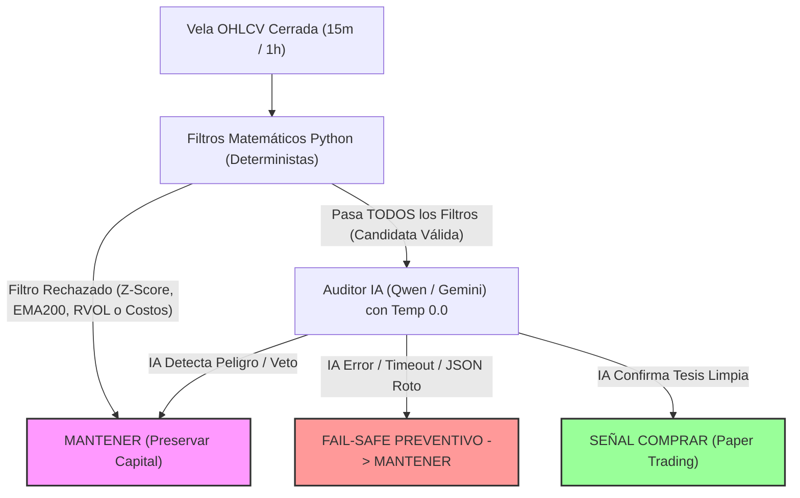

# 🤖 Plataforma Cuantitativa de Trading (AI Trading Bot)

Plataforma institucional de trading algorítmico, dashboard en tiempo real y simulación financiera (**Paper Trading local**) diseñada para operar activos líquidos (Criptomonedas 24/7 y Wall Street en horario regular), erradicando por completo el sesgo emocional, el pánico y la avaricia del inversor minorista.

> [!IMPORTANT]
> **ESTADO DE SEGURIDAD OPERATIVA: PAPER TRADING EXCLUSIVO**
> El sistema actual opera **100% en simulación local**. No contiene credenciales de brokers reales, no envía órdenes transaccionales a exchanges y no mueve dinero real. Todas las cuentas, saldos y ejecuciones se gestionan en memoria y almacenamiento local con propósitos de validación estadística y entrenamiento.

---

## 📖 Motivación del Proyecto (El "Por Qué")
Este proyecto nació de una historia real y trágica: un amigo cercano, tras consumir cursos de "gurús del trading", solicitó un préstamo de 5 millones de pesos para operar manualmente y lo perdió todo presa de la avaricia, el apalancamiento y el pánico. 

La realidad de los mercados es implacable: **el trading manual minorista es la pelea desigual de un humano con un ratón frente a supercomputadoras de alta frecuencia en Wall Street.**
El objetivo de este software es otorgar al operador su propio "Tanque de Guerra": un escudo algorítmico sin emociones, gobernado por matemáticas estrictas, filtros deterministas y auditoría de IA con salvaguardas de capital.

---

## 🧠 ¿Qué Hace y Qué NO Puede Hacer el Modelo de Inteligencia Artificial?

Para operar con éxito, el operador humano debe comprender con absoluta claridad cuál es el rol exacto de la Inteligencia Artificial (Qwen 2.5, DeepSeek, Gemini o Llama 3) en esta arquitectura.



### ✅ Lo que la IA SÍ hace:
1. **Auditoría Contextual de Noticias y Sentimiento:** Analiza titulares económicos y directivas macroeconómicas transmitidas por el proyecto satélite *Monitor del Mercado* y el *Antigravity CIO*.
2. **Rol Exclusivo de VETO en Estrategia Cuantitativa (ATR):** Cuando los algoritmos de Python detectan una candidata matemática perfecta, la IA es consultada únicamente para verificar si existen contradicciones macro o riesgos extremos. La IA tiene autoridad para **vetar** la operación (respondiendo `MANTENER`).
3. **Inferencia Determinista (Temperatura 0.0):** Cuando audita la estrategia cuantitativa, el modelo corre forzosamente a `temperature: 0.0` y con esquema JSON estructurado, eliminando respuestas poéticas, divagaciones y alucinaciones estilísticas.

### ❌ Lo que la IA NO PUEDE HACER (Prohibiciones Estrictas de Código):
1. **La IA NO calcula indicadores matemáticos:** La IA no calcula RSI, Z-Score, ATR ni EMA200. Esos cálculos los realiza Python de forma vectorizada y exacta.
2. **La IA NO puede forzar una compra rechazada por la matemática:** Si los filtros de Python determinan que el activo no cumple las condiciones, **el LLM ni siquiera es llamado**. Una alucinación del modelo jamás puede abrir un trade por su cuenta.
3. **La confianza del LLM NO es probabilidad matemática:** Si la IA dice *"estoy 85% segura"*, el sistema no interpreta ese número como una probabilidad de acierto para dimensionar apuestas.
4. **Freno de Mano Automático (*Fail-Safe*):** Si el servidor de Ollama se cae, se supera el tiempo límite (*timeout* de 60s/110s), la respuesta no tiene formato JSON válido o el modelo emite una acción no permitida, el sistema activa automáticamente el **Fail-Safe** y fuerza la señal a **`MANTENER`**. Ante cualquier duda informática, el dinero no se toca.

---

## 🛡️ El Escudo de Costos: "Beneficio Neto Mínimo" (Filtro Anti-Desgaste)

El factor número uno que quiebra a los traders algorítmicos minoristas es el **desgaste por comisiones (*churning*)**: abrir y cerrar muchas operaciones pequeñas donde las comisiones del broker se comen todo el saldo.

### ¿Cómo funciona el Beneficio Neto Mínimo?
En el panel de **Ajustes**, el operador puede definir el **Beneficio Neto Mínimo para Tomar Ganancias** (rango del 0% al 5%, valor sugerido: 0.15% en modo manual y 0.50% en modo ATR):
* **Fórmula de Ganancia Neta Real:**
  $$\text{Retorno Neto} = \left( (1 + \text{Movimiento Bruto}) \times \frac{(1 - \text{Fee}) \times (1 - \text{Spread})}{(1 + \text{Fee}) \times (1 + \text{Spread})} - 1 \right) \times 100$$
* **Filtro al Comprar:** Si el Take Profit proyectado (restando comisiones de compra, de venta y spread estimado en ambos lados) no supera el Beneficio Neto Mínimo configurado, **la compra se bloquea antes de ejecutarse**.
* **Filtro al Salir:** Si una posición abierta tiene una ganancia flotante micro-positiva (ej. +0.08%) pero no alcanza el Beneficio Neto Mínimo (ej. 0.15%), el sistema **prohíbe tomar beneficios prematuros** para evitar regalarle comisiones al broker.
* **Salvaguardas de Emergencia:** El Stop Loss, el Breakeven/Trailing Stop de protección, los cierres por invalidación técnica y el botón de Cierre Manual de Emergencia **NUNCA** se bloquean; la seguridad del capital siempre tiene prioridad de salida.

---

## 🧮 Catálogo Modular de Estrategias y Hub Visual

El sistema opera bajo un **Patrón Estrategia desacoplado** ubicado en [`backend/estrategias/`](file:///home/raul/Escritorio/proyectos/trading_ollama/backend/estrategias/). El operador puede explorar y activar cada estrategia directamente desde el nuevo **Hub de Estrategias** en el panel web (botón `🎯 Estrategias` en la barra superior o en Ajustes).

```text
trading_ollama/backend/estrategias/
├── base.py                   # Interfaz unificada (EstrategiaBase)
├── registry.py               # Catálogo dinámico y endpoint GET /api/strategies
├── mean_reversion_atr.py     # Reversión a la media institucional ATR
├── nasdaq_araujo_vwap.py     # Estrategia Nasdaq Franklin Araujo (VWAP + M15)
└── hyenuk_chu_multibagger.py # Estrategia Hyenuk Chu: Trend & Multibagger (1h)
```

### 1. Estrategia Cuantitativa ATR (Plan Argon)
* **Temporalidad Estricta:** 15m o 1h (rechazo de 1m/5m con HTTP 422).
* **Filtros Deterministas:**
  1. $Z\text{-Score}(20) \le -2.0$ (sobreventa estadística extrema).
  2. Régimen EMA200 alcista con pendiente no negativa.
  3. Mecha inferior de absorción $\ge 0.25$.
  4. Volumen relativo $\le 3.5$.
  5. Cobertura de costos $\ge 3.5\times$ con $\text{TP} = 2.5 \times \text{ATR14}$ y $\text{SL} = 1.5 \times \text{ATR14}$.
* **Supervisión IA:** El modelo (Gemini, Qwen, DeepSeek) corre a temperatura 0.0 y actúa exclusivamente con poder de veto.

### 2. Estrategia Nasdaq Araujo (VWAP + M15 + Sesión Londres)
Inspirada en las reglas objetivas de acción del precio de Franklin Araujo para el índice Nasdaq:
* **Activos Idóneos:** `QQQ`, `NQ=F`, `MNQ`.
* **Temporalidad Estricta:** Únicamente **15 minutos (`15m`)**.
* **Ventana Operativa:** Campana de apertura americana (09:25 – 11:30 AM NY).
* **Confluencia Requerida:**
  * **Largos (Compra):** Precio > VWAP diario acumulado (desde Asia 18:00 NY) **Y** Precio > Rango de sesión de Londres (03:00–09:00 NY) **Y** Ruptura del máximo reciente en M15.
  * **Cortos (Venta):** Precio < VWAP diario **Y** Precio < Rango de sesión de Londres **Y** Ruptura del mínimo reciente en M15.
* **Disciplina Estricta:** Stop Loss obligatorio colocado inmediatamente y límite estricto de **1 único trade por día**.

### 3. Estrategia Hyenuk Chu (Trend Following & Multibagger / 1h)
Inspirada en las lecciones y filosofía de 20 años de experiencia bursátil de Hyenuk Chu:
* **Activos Idóneos:** `NVDA`, `TSLA`, `BTC/USDT`, `SOL/USDT`, `QQQ` (activos de alto impulso).
* **Temporalidad Estricta:** **1 hora (`1h`)** para capturar tendencias limpias y eliminar el ruido intradía.
* **Filtros Institucionales:**
  1. **Alineación Tendencial:** Precio sobre SMA20 y sobre EMA200 con pendiente alcista sostenida.
  2. **Filtro Contrario Anti-Euforia:** Bloquea compras si $\text{RSI} > 75$ (Chu exige no comprar en techos de euforia consensuada ni perseguir impulsos parabólicos). Exige $\text{RSI} \ge 45$.
  3. **Volumen Participante:** RVOL $\ge 0.90$.
* **Política Asimétrica (Trim / "Peluqueo"):** Objetivo inicial para asegurar capital base y dejar correr el remanente en asimetría positiva hacia arriba libre de riesgo con Trailing Stop. Stop Loss obligatorio e inflexible.

---

## ⚖️ Gestión de Riesgo, Esperanza Matemática y Criterio de Kelly

En [`backend/quant_risk.py`](file:///home/raul/Escritorio/proyectos/trading_ollama/backend/quant_risk.py) se encuentra implementada la biblioteca matemática institucional para dimensionamiento de posiciones:

### 1. Esperanza Matemática Neta ($EV_{\text{neto}}$)
$$EV_{\text{neto}} = (P_w \cdot R_{\text{win, net}}) + ((1 - P_w) \cdot R_{\text{loss, net}})$$
Donde $P_w$ es la probabilidad real de acierto y $R_{\text{win, net}}$ / $R_{\text{loss, net}}$ son los retornos netos descontando costos una sola vez. Si $EV_{\text{neto}} \le 0$, el tamaño de la posición es estrictamente cero.

### 2. Criterio de Quarter-Kelly
$$f^* = \frac{P_w \cdot b - (1 - P_w)}{b}, \quad f_{\text{seguro}} = 0.25 \cdot f^*$$
Donde $b = |R_{\text{win, net}}| / |R_{\text{loss, net}}|$. Quarter-Kelly reduce la volatilidad de la curva de capital y protege contra rachas de pérdidas consecutivas.

### 3. ¿Por qué Kelly está APAGADO por defecto? (`kelly_active = False`)
* **Principio de Prudencia Financiera:** Para que el Criterio de Kelly funcione sin quebrar la cuenta, se necesita conocer con certeza estadística el valor de $P_w$.
* **Estado Actual:** El sistema **no inventa probabilidades** ni asume la confianza del LLM como $P_w$. Al no contar todavía con una base histórica etiquetada fuera de muestra (*out-of-sample*) evaluada en *walk-forward* con comisiones reales de al menos 30 operaciones ($N \ge 30$), el Criterio de Kelly permanece **DESACTIVADO POR DEFECTO** bajo estado `PENDIENTE_DE_VALIDACION_OUT_OF_SAMPLE`.
* **Alternativa Segura en Uso:** El bot utiliza un **Presupuesto Fijo de Riesgo** (por defecto **0.25% del capital total por trade**). La posición se calcula dividiendo ese presupuesto entre el porcentaje del Stop Loss neto, garantizando que si el trade falla, la pérdida nunca supere el 0.25% de la cuenta.

---

## 🔬 Simulador de Backtesting Offline (`backend/backtest.py`)

Se diseñó un simulador cuantitativo reproducible para poner a prueba la estrategia ATR sin conexión a internet ni consumo de saldo:
* **Generación Sintética Local:** Crea series temporales OHLCV deterministas (`generate_synthetic_ohlcv`) en memoria.
* **Sin Sesgo de Anticipación (*No Look-Ahead Bias*):** La vela $i$ se evalúa únicamente tras su cierre. La orden de compra se ejecuta en la apertura de la vela siguiente ($O_{i+1}$) con recargo por slippage.
* **Salida Intrabarra Conservadora:** Si durante una misma vela los precios máximo y mínimo tocan simultáneamente el TP y el SL, el simulador asume que saltó el Stop Loss (prioridad a la preservación del capital).
* **Auditoría Estadística:** Incluye cálculo de Drawdown Máximo, Factor de Beneficio y validación fuera de muestra mediante el intervalo de confianza de Wilson al 95%.

---

## 🚀 Instalación y Puesta en Marcha

### Requisitos Previos
* Linux o Windows con Python 3.10 o superior instalado.
* Ollama local (opcional, para ejecutar Qwen 2.5 3B localmente).
* Node.js (opcional, para correr las pruebas unitarias del frontend).

### 1. Clonar e Instalar Entorno Virtual
```bash
git clone https://github.com/tu-usuario/trading_ollama.git
cd trading_ollama

# Crear entorno virtual
python3 -m venv venv

# Instalar dependencias backend
venv/bin/python -m pip install -r backend/requirements.txt
```

*(En Windows, utiliza `py -m venv venv` y `venv\Scripts\python.exe -m pip install -r backend\requirements.txt`)*.

### 2. Variables de Entorno (Opcional)
Copia `.env.example` a `.env` en la raíz si deseas configurar tokens de acceso o claves opcionales:
```bash
cp backend/.env.example .env
```

### 3. Ejecutar los Lanzadores Seguros
* **Solo Trading Ollama, en Linux:**
  ```bash
  chmod +x lanzar_bot.sh
  ./lanzar_bot.sh
  ```
* **En Windows:**
  Doble clic en `lanzar_bot.bat`.

Para iniciar Trading Ollama y el proyecto vecino **Monitor del Mercado** como una unidad, usa `lanzar_todo.sh` (Linux) o `lanzar_todo.bat` (Windows). Ollama debe estar ejecutándose; el coordinador no inicia ni detiene el servicio de Ollama. Comprueba que los puertos `18767`, `18087` y `8520` estén libres. Si el Monitor no está en `../monitor del mercado`, define `MONITOR_PROJECT_DIR` con su ruta antes de lanzar.

Los selectores de Pre-Market y Trinchera comparten el estado guardado en `backend/config/brain_state.json`. El endpoint `/api/system/models` descubre las etiquetas instaladas en Ollama; el estado central se expone en `/api/system/brain`. Ambos proyectos deben ejecutarse en la misma máquina para compartir esta selección.

Los lanzadores verificarán los puertos locales:
* **API Backend:** `http://127.0.0.1:18767`
* **Dashboard Frontend:** `http://127.0.0.1:18087`

---

## 🧪 Verificación y Batería de Pruebas

Toda modificación en el sistema está respaldada por pruebas automatizadas sin dependencias externas:

```bash
# 1. Pruebas unitarias de guardas del Frontend (Node.js)
node --test tests/frontend_trading_guards.test.cjs

# 2. Pruebas unitarias cuantitativas y regresiones del Backend (Pytest)
venv/bin/python -m pytest tests/
```

*Cobertura actual: 9 pruebas de interfaz y 53 pruebas de backend (62 pruebas en total, 100% aprobadas).*

---

## 📌 Guía Rápida para el Operador en el Dashboard
1. **Lobby Macro (Pestaña Inicial):** Revisa el *Radar de Oportunidades* alimentado por el Agente de Inversiones y el CIO. Elige qué activo te interesa analizar.
2. **Entrar a la Trinchera:** Accede al simulador interactivo con gráfico TradingView en tiempo real.
3. **Elegir Modo de Estrategia:**
   * **Manual:** Ajusta libremente tu TP y SL en el desplegable.
   * **Estrategia Cuantitativa ATR:** Se activan las velas de 15m/1h, el dimensionamiento institucional (0.25% de riesgo) y los filtros Z-Score/EMA200.
4. **Verificar Comisiones:** Asegúrate de que el Beneficio Neto Mínimo (ej. 0.15%) y las comisiones del broker reflejen los costos de tu exchange de referencia.
5. **Activar Botón:** Enciende el Agente en modo *Copiloto* (te pedirá confirmación antes de abrir un trade) o modo *Autónomo* (ejecución automática en Paper Trading).
